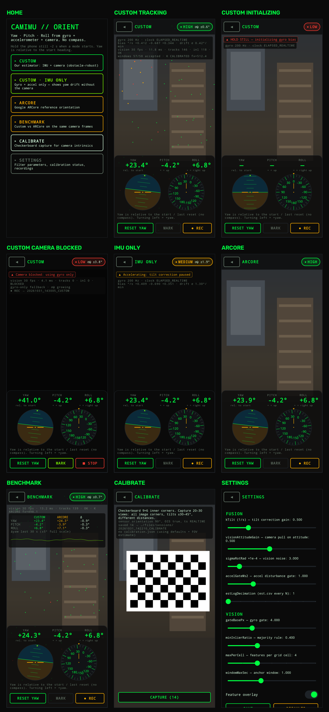

# CamIMU-Orient

Real-time **yaw / pitch / roll** for an Android phone using only the **gyroscope, accelerometer and back camera**.
**No compass, no magnetometer.**

- **Pitch and roll** are absolute (relative to gravity / the horizon).
- **Yaw is relative**: 0 is the heading at start or at the last **Reset yaw**. Without a compass there's no
  physical way to know north, so this is a property of the problem, not a bug. Turning left increases yaw.
- The camera keeps yaw from drifting: it measures how the scene rotates, which corrects the gyro's bias.
  Moving people and blocked lenses are detected and ignored. The app falls back to gyro-only and shows lower confidence.

Status: **implemented**. All code builds, 83 JVM tests pass, lint is clean, and a synthetic end-to-end session matches
truth (median yaw error 0.11°). **Not yet run on a phone.** The on-device checks are listed in
[docs/Progress.md](docs/Progress.md) under "Device checklist".

## Quick start (laptop + phone)
```bash
./scripts/verify.sh                 # guard + tests + build + lint (≈1–2 min warm)
adb devices                         # phone with USB debugging → "device"
./gradlew :app:installDebug
adb shell am start -n com.camimu.orient/.MainActivity
```
In the app: open **CUSTOM**, hold the phone still ~2 s, then move. Point it at a detailed scene ≥ 2 m away.
**REC** records a replayable session. **MARK** tags reference poses. **RESET YAW** zeroes the heading.

## Modes
| Mode | What it does |
|---|---|
| ARCore | Google ARCore's orientation (reference baseline) |
| Custom | Our estimator: gyro + accel + camera |
| Custom IMU-only | Our estimator without camera (shows gyro drift) |
| Benchmark | Custom and ARCore side by side on the same camera frames |
| Calibrate | Capture checkerboard images / calibration recordings |

## How it works (short)
1. The gyro is integrated into a quaternion at ~200 Hz.
2. The accelerometer's gravity direction corrects pitch/roll (complementary filter).
3. The camera tracks corners (OpenCV KLT). Features that disagree with the gyro's prediction (e.g. a walking person) are dropped.
   RANSAC finds the rotation most points agree on.
4. Every ~1 s the camera rotation is compared with the gyro's. The difference feeds a small Kalman filter
   that estimates the gyro bias, and the attitude is nudged toward the camera's answer.

Details: [docs/Architecture.md](docs/Architecture.md). Full spec: [project.md](project.md).

## Screenshots
Rendered from the real Compose UI with Paparazzi (`./gradlew :app:recordPaparazziDebug`, then copied to `docs/screenshots/`).
Camera views show a synthetic scene because no camera is available on the laptop; everything drawn on top is the app's HUD code.



## UI palette
HUD style from the open-design.ai "HUD" design system (https://open-design.ai/systems/hud/):
near-black `#0A0A0A` / `#111316` / `#1E2328`, phosphor green `#00FF41`, lime `#7FFF00`, plus amber `#FFB000` and red `#FF3B30` for
MEDIUM/LOW confidence.

## Setup
Requirements: Linux/macOS/Windows with Android Studio (latest stable), JDK 17 (bundled with Studio), Python 3.10+,
and a real Android phone (Android 8.0+, gyroscope; ARCore support for ARCore/Benchmark modes). Emulators can't be used, because they have no real IMU/camera.
Step-by-step: [docs/Implementation.md → Before you start](docs/Implementation.md#before-you-start).

```bash
# JDK 17 is pinned in gradle.properties (org.gradle.java.home); adjust it on another machine
echo "sdk.dir=$HOME/Android/Sdk" > local.properties
python3 -m venv .venv && . .venv/bin/activate && pip install -r tools/requirements.txt
```

## Build & run
```bash
./gradlew :app:assembleDebug        # build
adb devices                         # phone must show as "device" (USB debugging on)
./gradlew :app:installDebug         # install
adb shell am start -n com.camimu.orient/.MainActivity
```
Usage: hold the phone still for ~2 s after opening a mode (initialization), then move freely. Press **Reset yaw** to zero the heading.

## Test
```bash
./scripts/verify.sh                          # all checks (forbidden-API guard, unit tests, build, lint)
./gradlew :core:test                         # math/fusion unit tests: laptop only, no phone
./gradlew :app:connectedDebugAndroidTest     # instrumented tests (phone connected)
```

## Record, replay, analyze
```bash
# record a session in the app (Start logging), then:
adb pull /sdcard/Android/data/com.camimu.orient/files/sessions/ ./sessions/
./gradlew :replay:run --args="--session sessions/<name>"                     # re-run the estimator offline
./gradlew :replay:run --args="--session sessions/<name> --config tuning/x.json --out sessions/<name>/replay_x"
python3 tools/analyze_log.py sessions/<name>                                  # plots + metrics.json
```

## Calibration (per phone)
Camera intrinsics (checkerboard), gyro noise (Allan variance), camera–IMU time offset:
[docs/Implementation.md → Phase 5](docs/Implementation.md#phase-5--calibration).

## Compass-free guarantee
- `scripts/check_forbidden_apis.sh` fails the build if any magnetometer/compass API appears in source.
- Every session's `meta.json` lists the sensors actually registered (gyroscope + accelerometer only).
- ARCore (reference mode only) is a closed-source library; the compass-free claim applies to the Custom estimator.

## Accuracy
Targets (not guarantees) are in [docs/PRD.md §5](docs/PRD.md). Measured results per device go in `docs/Results.md` (created in Phase 7).

## Docs
| File | Purpose |
|---|---|
| [CLAUDE.md](CLAUDE.md) | Rules and commands for Claude Code (read every session) |
| [docs/Implementation.md](docs/Implementation.md) | Phase-by-phase build plan (main file) |
| [docs/Architecture.md](docs/Architecture.md) | Components, threads, frames, formulas |
| [docs/DataModel.md](docs/DataModel.md) | Classes, configs, CSV schemas |
| [docs/Rules.md](docs/Rules.md) | Coding conventions, forbidden APIs |
| [docs/PRD.md](docs/PRD.md) | Requirements and targets |
| [docs/TestPlan.md](docs/TestPlan.md) | Tests, scenarios, metrics |
| [docs/Decisions.md](docs/Decisions.md) | Design decisions (ADRs) |
| [docs/Progress.md](docs/Progress.md) | Task tracker |
| [docs/Issues.md](docs/Issues.md) | Risks, open questions, VERIFY list |
| [docs/Prompts.md](docs/Prompts.md) | Prompts to drive Claude Code |
# camIMU
